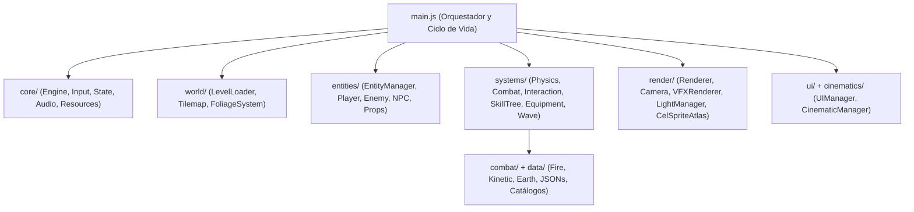
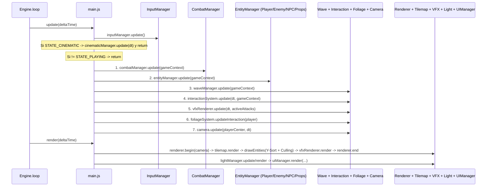
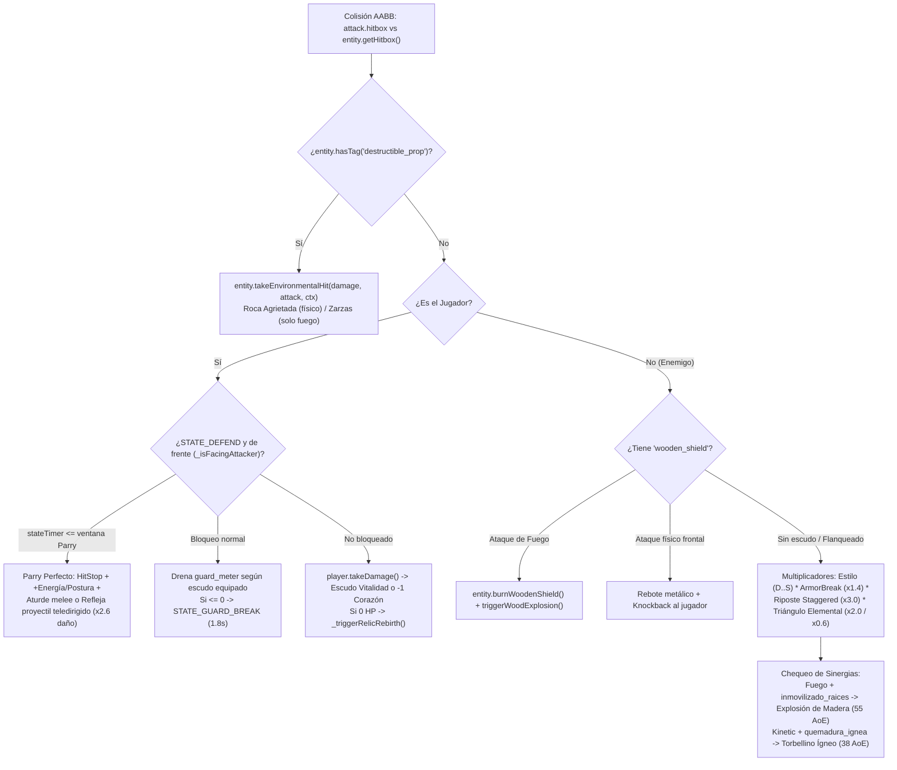

# Manual de Auditoría: Estructura, Escritura y Conexión de las Funciones Lógicas

> [!IMPORTANT]
> Este documento actúa como **mapa de trazabilidad técnica** de *Be a Legend*. Describe cómo se organizan los módulos en disco, qué reglas de ingeniería siguen sus funciones internas, cómo viajan los datos en cada fotograma y dónde auditar cada subsistema con enlaces directos al código fuente.

---

## 1. Estructura Arquitectónica por Capas (Taxonomía de Módulos)

El proyecto sigue una arquitectura modular **desacoplada en 9 capas** bajo `src/`. La regla de oro del motor es la **separación estricta entre Simulación (Canvas/JS) y Presentación (DOM Overlay/CSS)**: ninguna entidad toca el DOM directamente y ningún botón HTML modifica coordenadas de entidades sin pasar por un gestor o el bus de estado.



| Capa | Archivos Principales | Responsabilidad Lógica Exacta |
| :--- | :--- | :--- |
| **Orquestador** | [main.js](file:///c:/Users/user/Desktop/video%20proyectos/Be%20a%20legend/src/main.js) | Instancia sistemas, construye `gameContext`, ejecuta `update(dt)` / `render(dt)` y conecta eventos de teclado/menús. |
| **Core** | [`Engine`](file:///c:/Users/user/Desktop/video%20proyectos/Be%20a%20legend/src/core/Engine.js), [`InputManager`](file:///c:/Users/user/Desktop/video%20proyectos/Be%20a%20legend/src/core/InputManager.js), [`StateManager`](file:///c:/Users/user/Desktop/video%20proyectos/Be%20a%20legend/src/core/StateManager.js), [`AudioManager`](file:///c:/Users/user/Desktop/video%20proyectos/Be%20a%20legend/src/core/AudioManager.js), [`ResourceManager`](file:///c:/Users/user/Desktop/video%20proyectos/Be%20a%20legend/src/core/ResourceManager.js) | Reloj `requestAnimationFrame` + *HitStop*, entrada híbrida (PC/Táctil), bus clave-valor reactivo, síntesis Web Audio y carga tolerante a fallos. |
| **Entidades** | [`Entity`](file:///c:/Users/user/Desktop/video%20proyectos/Be%20a%20legend/src/entities/Entity.js), [`EntityManager`](file:///c:/Users/user/Desktop/video%20proyectos/Be%20a%20legend/src/entities/EntityManager.js), [`Player`](file:///c:/Users/user/Desktop/video%20proyectos/Be%20a%20legend/src/entities/Player.js), [`Enemy`](file:///c:/Users/user/Desktop/video%20proyectos/Be%20a%20legend/src/entities/Enemy.js), [`NPC`](file:///c:/Users/user/Desktop/video%20proyectos/Be%20a%20legend/src/entities/NPC.js), [`InteractableProp`](file:///c:/Users/user/Desktop/video%20proyectos/Be%20a%20legend/src/entities/InteractableProp.js) | Objetos del mundo con `pos`, `hitbox` en los pies, etiquetas estáticas (`tags`), estados alterados temporales (`activeEffects`) y máquinas de estados (FSM). |
| **Sistemas** | [`PhysicsSystem`](file:///c:/Users/user/Desktop/video%20proyectos/Be%20a%20legend/src/systems/PhysicsSystem.js), [`CombatManager`](file:///c:/Users/user/Desktop/video%20proyectos/Be%20a%20legend/src/systems/CombatManager.js), [`InteractionSystem`](file:///c:/Users/user/Desktop/video%20proyectos/Be%20a%20legend/src/systems/InteractionSystem.js), [`SkillTreeManager`](file:///c:/Users/user/Desktop/video%20proyectos/Be%20a%20legend/src/systems/SkillTreeManager.js), [`EquipmentManager`](file:///c:/Users/user/Desktop/video%20proyectos/Be%20a%20legend/src/systems/EquipmentManager.js), [`WaveManager`](file:///c:/Users/user/Desktop/video%20proyectos/Be%20a%20legend/src/systems/WaveManager.js) | Reglas transversales puras: colisión AABB con deslizamiento, resolución de golpes/parries/sinergias, proximidad `[E]`, progresión persistida en `localStorage` y oleadas. |
| **Habilidades** | [`FireAbility`](file:///c:/Users/user/Desktop/video%20proyectos/Be%20a%20legend/src/combat/FireAbility.js), [`KineticAbility`](file:///c:/Users/user/Desktop/video%20proyectos/Be%20a%20legend/src/combat/KineticAbility.js), [`EarthAbility`](file:///c:/Users/user/Desktop/video%20proyectos/Be%20a%20legend/src/combat/EarthAbility.js) | Fábricas de descriptores de ataque (`executeWeak` / `executeStrong`) que inyectan proyectiles, embestidas o áreas en `CombatManager.activeAttacks`. |
| **Mundo y Datos** | [`LevelLoader`](file:///c:/Users/user/Desktop/video%20proyectos/Be%20a%20legend/src/world/LevelLoader.js), [`Tilemap`](file:///c:/Users/user/Desktop/video%20proyectos/Be%20a%20legend/src/world/Tilemap.js), [`FoliageSystem`](file:///c:/Users/user/Desktop/video%20proyectos/Be%20a%20legend/src/world/FoliageSystem.js), [cave_exit_intro.json](file:///c:/Users/user/Desktop/video%20proyectos/Be%20a%20legend/src/data/levels/cave_exit_intro.json) | Construcción declarativa de niveles desde JSON, terreno multicapa pre-renderizado $O(1)$ y vegetación con física de resorte amortiguado. |
| **Render y UI** | [`Renderer`](file:///c:/Users/user/Desktop/video%20proyectos/Be%20a%20legend/src/render/Renderer.js), [`Camera`](file:///c:/Users/user/Desktop/video%20proyectos/Be%20a%20legend/src/render/Camera.js), [`CelSpriteAtlas`](file:///c:/Users/user/Desktop/video%20proyectos/Be%20a%20legend/src/render/CelSpriteAtlas.js), [`UIManager`](file:///c:/Users/user/Desktop/video%20proyectos/Be%20a%20legend/src/ui/UIManager.js), [`CinematicManager`](file:///c:/Users/user/Desktop/video%20proyectos/Be%20a%20legend/src/cinematics/CinematicManager.js) | Y-Sorting, *Frustum Culling*, horneado de sprites 2D Cel-Shaded, HUD responsivo `16:9`/`9:16` con *dirty-checking* y secuencias narrativas. |

---

## 2. Cómo Están Escritas las Funciones Lógicas (5 Patrones de Ingeniería)

Al auditar cualquier archivo del proyecto, verás que todas las funciones críticas obedecen **5 convenciones de escritura**:

### 2.1 Inyección de Dependencias por Contexto Unificado (`gameContext`)
En lugar de usar variables globales o `import` circulares entre `Player`, `Enemy`, `CombatManager` e `InteractableProp`, [`buildGameContext(deltaTime)`](file:///c:/Users/user/Desktop/video%20proyectos/Be%20a%20legend/src/main.js#L186-L208) empaqueta en un solo objeto todas las referencias activas del frame:

```js
// Estructura estándar recibida por update(context), handleHit(..., context) e interact(state, context)
{
  deltaTime, input, state, physics, player, camera,
  entityManager, combatManager, equipmentManager,
  skillTreeManager, waveManager, audioManager,
  vfxRenderer, uiManager, engine, time, ctx
}
```
- **Qué auditar:** Toda función lógica que dispare sonido, cámara o partículas verifica defensivamente su existencia (`if (context && context.audioManager) ...`), permitiendo ejecutar pruebas automatizadas en Node.js sin navegador ni Web Audio.

### 2.2 Cero Asignaciones Dinámicas en *Hot-Paths* (Anti-Garbage Collector)
Las funciones que corren decenas o cientos de veces por fotograma **reutilizan objetos pre-alocados en el constructor** en vez de hacer `return { x, y }` nuevos:
- [`Entity.getHitbox()`](file:///c:/Users/user/Desktop/video%20proyectos/Be%20a%20legend/src/entities/Entity.js#L102-L108) muta y devuelve `this._hitboxCache`. **Regla de auditoría:** nunca guardes la referencia devuelta por `getHitbox()` entre dos entidades distintas sin leer sus campos antes, o usa un rectángulo de prueba dedicado como `this._testBox` en [`PhysicsSystem.moveWithCollisions()`](file:///c:/Users/user/Desktop/video%20proyectos/Be%20a%20legend/src/systems/PhysicsSystem.js#L48-L99).
- [`EntityManager.getSolids()`](file:///c:/Users/user/Desktop/video%20proyectos/Be%20a%20legend/src/entities/EntityManager.js#L103-L108) mantiene `this._solidsCache` persistente y solo la recalcula cuando `addEntity`, `removeEntity` o la muerte de un enemigo/obstáculo la invalida (`_solidsCache = null`).
- [`EntityManager.getEntities()`](file:///c:/Users/user/Desktop/video%20proyectos/Be%20a%20legend/src/entities/EntityManager.js#L75-L87) ordena *in-place* `this._sortedBuffer` según la coordenada Y de la base de los pies (`pos.y + hitbox.offsetY + hitbox.height`).

### 2.3 Sistema Unificado de Identidad y Estados Alterados (`hasTag`)
En [`Entity.hasTag(tag)`](file:///c:/Users/user/Desktop/video%20proyectos/Be%20a%20legend/src/entities/Entity.js#L110-L112):
```js
hasTag(tag) {
  return this.tags.includes(tag) || this.activeEffects.has(tag);
}
```
Esto unifica en **una sola consulta** tanto etiquetas permanentes (`'player'`, `'enemy'`, `'solid'`, `'wooden_shield'`, `'destructible_prop'`) como estados temporales con duración en segundos (`'iframe'`, `'staggered'`, `'inmovilizado_raices'`, `'quemadura_ignea'`, `'armor_break'`, `'vitality_shield'`), cuyos temporizadores se descuentan automáticamente en [`Entity.update(context)`](file:///c:/Users/user/Desktop/video%20proyectos/Be%20a%20legend/src/entities/Entity.js#L72-L87).

### 2.4 *Dirty-Checking* Estricto en el DOM Overlay
[`UIManager`](file:///c:/Users/user/Desktop/video%20proyectos/Be%20a%20legend/src/ui/UIManager.js) se invoca en cada frame de `render()`, pero guarda sombras del último valor pintado (`_lastHealth`, `_lastEnergy`, `_lastPosture`, `_lastPowerSignature`, `_lastGameState`, `_lastObjectiveText`). Si el valor no cambió más allá del umbral (`0.4`–`0.5%`), **la función retorna sin tocar el DOM**, garantizando 0 *reflows* en reposo.

### 2.5 Descriptores Funcionales Autónomos de Ataque (`activeAttacks`)
En vez de codificar cada proyectil o barrido dentro de `CombatManager`, las armas y habilidades llaman a [`combatManager.addAttack(attackObj)`](file:///c:/Users/user/Desktop/video%20proyectos/Be%20a%20legend/src/systems/CombatManager.js#L696-L701) pasando un objeto plano con:
- Datos declarativos (`owner`, `element`, `damage`, `duration`, `hitbox`, `destroyOnHit`, `applyEffect`).
- Deduplicación por impacto (`hitEntities: new Set()`) para que un mismo tajo de 0.18s no golpee 10 veces al mismo enemigo en 10 frames consecutivos.
- Callback opcional `update(dt)` propio del ataque (p. ej. mover una bola de fuego, arrastrar enemigos en [`KineticAbility`](file:///c:/Users/user/Desktop/video%20proyectos/Be%20a%20legend/src/combat/KineticAbility.js#L60-L78) o atraerlos hacia la espada en [`EarthAbility`](file:///c:/Users/user/Desktop/video%20proyectos/Be%20a%20legend/src/combat/EarthAbility.js#L62-L82)).

---

## 3. Cómo se Conectan las Funciones en Tiempo de Ejecución (Game Loop)

Cada fotograma nace en [`Engine.loop(currentTime)`](file:///c:/Users/user/Desktop/video%20proyectos/Be%20a%20legend/src/core/Engine.js#L91-L121), que acota `deltaTime <= 0.1s` (evitando túneles de colisión al cambiar de pestaña) y decide entre tres ramas:
1. **`engine.isPaused === true`** (Menú o Santuario abierto): omite `updateFn` y llama `renderFn(0)`.
2. **`engine.hitStopTimer > 0`** (Congelación de milisegundos tras Parry o golpe pesado): descuenta `hitStopTimer`, congela la lógica y llama `renderFn(0)` para dar impacto visceral.
3. **Flujo Normal (`STATE_PLAYING`)**: ejecuta [`update(deltaTime)`](file:///c:/Users/user/Desktop/video%20proyectos/Be%20a%20legend/src/main.js#L211-L237) e inmediatamente después [`render(deltaTime)`](file:///c:/Users/user/Desktop/video%20proyectos/Be%20a%20legend/src/main.js#L240-L257).



> [!TIP]
> **¿Por qué importa este orden exacto al auditar?**
> `combatManager.update` corre **antes** de `entityManager.update` para resolver impactos de proyectiles/barridos ya emitidos; acto seguido, `Player.update` y `Enemy.update` leen el estado resultante (postura, *stagger*, enfriamientos) y responden en el mismo frame sin retardo perceptible. Al final, `camera.update` calcula la posición ya resuelta por `PhysicsSystem` para que el renderizado no sufra *jitter* (temblor entre personaje y cámara).

---

## 4. Trazabilidad de las 5 Cadenas Lógicas Principales

### Cadena A: Entrada Híbrida $\rightarrow$ Apuntado 360° $\rightarrow$ FSM del Jugador
1. **Captura y Buffer (`200ms`):** [`InputManager._bindEvents()`](file:///c:/Users/user/Desktop/video%20proyectos/Be%20a%20legend/src/core/InputManager.js#L285-L355) y los botones táctiles llaman a `triggerAction('attack' | 'ability' | 'strong' | 'dash' | 'heal', 200)`. La bandera queda activa hasta `200ms` o hasta que [`Player.update()`](file:///c:/Users/user/Desktop/video%20proyectos/Be%20a%20legend/src/entities/Player.js#L624-L950) la consume con `consumeAttack()`, etc.
2. **Orientación Garantizada:** [`Player._updateSmartAim()`](file:///c:/Users/user/Desktop/video%20proyectos/Be%20a%20legend/src/entities/Player.js#L212-L237) y `_syncFacingFromVector()` priorizan siempre el vector de movimiento activo (`WASD` / Flechas / Joystick) y, en reposo, respetan `this.facing`, proyectando el hitbox de espada en `this.aimDir` mediante [`getSwordSweepHitbox()`](file:///c:/Users/user/Desktop/video%20proyectos/Be%20a%20legend/src/entities/Player.js#L245-L261).
3. **Prioridades y Cancelaciones en la FSM de `Player`:**
   - **Guardia/Parry (`[Shift]`):** Puede cancelar la recuperación de un ataque para alzar `STATE_DEFEND` al instante; si `parryCooldown <= 0`, inicia `stateTimer = 0` abriendo la ventana de Parry Perfecto (`160ms` base / `250ms` con talento `parry_window`).
   - **Dash Cancel (`[Espacio]`):** Cancela cualquier estado salvo `STATE_GUARD_BREAK`, limpia barridos cuerpo a cuerpo activos con `combatManager.cancelAttacksFrom(this)` y otorga invulnerabilidad (`applyEffect('iframe', duration + 0.06)`).
   - **Dash-Strike:** Si se pulsa ataque mientras `isDashing === true`, [`_executeSwordCombo()`](file:///c:/Users/user/Desktop/video%20proyectos/Be%20a%20legend/src/entities/Player.js#L414-L488) ejecuta una estocada perforante y enlaza directo al Golpe 2 del combo.
   - **Input Queueing y Spell-Weaving:** Durante los últimos `105ms` de un golpe (`attackTimer <= 0.105`), se encola la siguiente pulsación en `this.queuedAction`; en los últimos `85ms` (`canSpellWeave`) un hechizo cancela limpiamente la recuperación de la espada.

### Cadena B: Resolución Simétrica de Combate, Escudos y Sinergias
Todo impacto pasa por [`CombatManager.update()`](file:///c:/Users/user/Desktop/video%20proyectos/Be%20a%20legend/src/systems/CombatManager.js#L121-L238) $\rightarrow$ [`CombatManager.handleHit(attack, entity, context)`](file:///c:/Users/user/Desktop/video%20proyectos/Be%20a%20legend/src/systems/CombatManager.js#L303-L632):



### Cadena C: IA de los 4 Arquetipos Enemigos y Hordas Bajo Demanda
- **Ciclo de IA ([`Enemy.update`](file:///c:/Users/user/Desktop/video%20proyectos/Be%20a%20legend/src/entities/Enemy.js)):** Ejecuta una máquina de 6 estados (`IDLE` $\rightarrow$ `PATROL` $\rightarrow$ `CHASE` $\rightarrow$ `TELEGRAPH` $\rightarrow$ `ATTACK` $\rightarrow$ `COOLDOWN`). Durante `TELEGRAPH` emite `audioManager.playTelegraph()` y un destello visual antes de lanzar su ataque, dando ventana justa de lectura para el Parry.
- **Derrota Limpia ([`Enemy._handleDefeat`](file:///c:/Users/user/Desktop/video%20proyectos/Be%20a%20legend/src/entities/Enemy.js#L232-L280)):** Retira `'solid'`, invalida `entityManager._solidsCache`, cancela ataques melee pendientes (`cancelAttacksFrom(this)`), suma Esencia mediante `skillTreeManager.addEssence(reward)` y, si tiene `noRespawn` (enemigos narrativos o de oleada), se remueve del `EntityManager`.
- **Hordas ([`WaveManager`](file:///c:/Users/user/Desktop/video%20proyectos/Be%20a%20legend/src/systems/WaveManager.js)):** Permanece en `IDLE` (`autoStart = false`) hasta que el jugador activa la `horde_totem` o el botón del Códice (`waveManager.startHorde(context)`), reposicionando las coordenadas de generación alrededor de `arenaCenter` (`{ x: 1340, y: 830 }` en el nivel introductorio).

### Cadena D: Progresión del Nivel Introductorio y Karma Invisible
1. **Carga Declarativa:** [`LevelLoader.loadLevel()`](file:///c:/Users/user/Desktop/video%20proyectos/Be%20a%20legend/src/world/LevelLoader.js#L51-L181) lee [cave_exit_intro.json](file:///c:/Users/user/Desktop/video%20proyectos/Be%20a%20legend/src/data/levels/cave_exit_intro.json), fija los límites de `Camera`, crea colisionadores invisibles para el arroyo y las paredes del cañón (`InvisibleBarrier`), e instancia [`InteractableProp`](file:///c:/Users/user/Desktop/video%20proyectos/Be%20a%20legend/src/entities/InteractableProp.js), [`NPC`](file:///c:/Users/user/Desktop/video%20proyectos/Be%20a%20legend/src/entities/NPC.js) y [`Enemy`](file:///c:/Users/user/Desktop/video%20proyectos/Be%20a%20legend/src/entities/Enemy.js).
2. **Progresión sin Disonancia Ludonarrativa:**
   - Al iniciar (`startDormant: true`), `player.configureDormantStart()` vacía `unlockedElements` y fija `gauntlet_tier = 0`, `intro_stage = 0`.
   - Romper `cracked_rock` con la espada sube `intro_stage = 1`.
   - Tocar o pulsar `[E]` en `relic_pedestal` despierta `'Fuego'`, sube `gauntlet_tier = 1` e `intro_stage = 2`.
   - Quemar `burnable_vines` con Fuego libera el puente y sube `intro_stage = 3`.
   - Activar `sanctuary_altar` armoniza los 3 elementos (`gauntlet_tier = 3`, `intro_stage = 4`) e invoca `open_sanctuary_hook('skills')`.
3. **Karma Invisible ([`NPC.update`](file:///c:/Users/user/Desktop/video%20proyectos/Be%20a%20legend/src/entities/NPC.js#L75-L117)):** Valerio vigila los enemigos con etiqueta `ambush_valerio`. En el primer frame registra `this.hadAmbushers = true`; en cuanto el jugador derrota a todos (`aliveAmbushers.length === 0`), ejecuta `_completeInvisibleKarmaRescue()`, subiendo `karma_level` internamente (`+1`), marcando `valerio_rescued = true`, otorgando `+25` de Esencia y alterando el saludo de **Sabio Tarak** sin mostrar medidores numéricos de moralidad.

---

## 5. Tabla Maestra de Contratos en `StateManager`

Cualquier auditoría entre la lógica del juego y la interfaz debe verificar estas claves en [`StateManager`](file:///c:/Users/user/Desktop/video%20proyectos/Be%20a%20legend/src/core/StateManager.js):

| Clave en `StateManager` | Quién Escribe (Productor) | Quién Lee (Consumidor) | Uso Lógico |
| :--- | :--- | :--- | :--- |
| `game_state` | `main.js`, `CinematicManager` | `main.js`, `UIManager.setGameState` | Controla el aislamiento estricto entre `'STATE_MENU'`, `'STATE_CINEMATIC'`, `'STATE_PLAYING'` y `'STATE_PAUSED'`. |
| `gauntlet_tier` | `main.js`, `InteractableProp` | `UIManager.updateHUD`, `renderCodexTab`, `main.js` | `0`: Guantelete latente (`LATENTE`), `1`: Fuego despierto, `3`: Reliquia armonizada completa. |
| `intro_stage` | `main.js`, `InteractableProp` | `InteractableProp`, `UIManager.renderCodexTab` | Etapa actual del nivel introductorio (`0` a `4`) para hitos de la Crónica. |
| `level_objective` | `main.js`, `InteractableProp` | `UIManager.updateHordeHUD`, `renderCodexTab` | Texto vivo del indicador superior de rumbo (`#objective-hud-text`). |
| `equipped_power` | `main.js`, `InteractableProp`, `UIManager` | `UIManager.updateHUD`, `renderArsenalTab` | Nombre del elemento activo (`'Fuego'`, `'Embestida'`, `'Raíces'`). |
| `player_health` / `player_max_health` | `Player`, `SkillTreeManager`, `InteractableProp` | `UIManager.updateHUD` | Corazones actuales y cámaras máximas de vitalidad (`3` o `4`). |
| `player_energy` / `player_posture` | `Player`, `CombatManager` | `UIManager.updateHUD` | Porcentaje `[0..100]` de Energía Elemental y Égida/Postura. |
| `player_essence` / `unlocked_skills` | `SkillTreeManager`, `InteractableProp` | `UIManager.updateComboAndEssence`, `renderSkillTree` | Moneda de progresión y arreglo de nodos despertados (persistidos en `localStorage`). |
| `combo_count` / `combo_rank` / `combo_timer_pct` | `CombatManager._syncComboState` | `UIManager.updateComboAndEssence` | Contador de racha, letra de rango (`D`–`S`) y barra de tiempo restante. |
| `active_threat` | `CombatManager.update` | `UIManager.updateBossThreat` | Datos del enemigo golpeado recientemente (`name`, `health`, `maxHealth`, `hasShield`). |
| `horde_wave_number` / `horde_banner_active` | `WaveManager` | `UIManager.updateHordeHUD` | Estado del tracker de oleadas (oculto si `<= 0`) y disparo de banners superiores. |
| `active_dialogue` | `InteractionSystem`, `InteractableProp`, `NPC`, `Player`, `main.js` | `UIManager.updateDialogue` | Objeto `{ speaker, text, timer }` para la tarjeta diegética inferior. |
| `karma_level` / `valerio_rescued` | `NPC._completeInvisibleKarmaRescue` | `NPC.interact` (Sabio Tarak) | Estado moral invisible que altera diálogos del mundo sin exponerse como barra UI. |
| `open_sanctuary_hook` | `main.js` | `InteractableProp.interact` (`sanctuary_altar`) | Callback que abre limpiamente el Hub del Santuario en la pestaña indicada. |

---

## 6. Catálogo de Funciones Críticas: Firmas, Entradas, Efectos e Invariantes

Para auditar línea por línea sin perder el hilo entre archivos, esta tabla resume el contrato exacto de las funciones nucleares del motor:

| Función y Ubicación | Entrada Principal | Efecto / Salida | Invariante que Debes Verificar al Auditar |
| :--- | :--- | :--- | :--- |
| [`buildGameContext(dt)`](file:///c:/Users/user/Desktop/video%20proyectos/Be%20a%20legend/src/main.js#L189-L209) | `deltaTime` (segundos) | Objeto inyectable con todos los gestores activos. | Si agregas un nuevo sistema transversal, regístralo aquí para que `Player`, `Enemy` y `Props` lo reciban sin `import` circular. |
| [`openSanctuary(tab)`](file:///c:/Users/user/Desktop/video%20proyectos/Be%20a%20legend/src/main.js#L363-L392) / [`closeSanctuary()`](file:///c:/Users/user/Desktop/video%20proyectos/Be%20a%20legend/src/main.js#L394-L406) | `'skills' \| 'arsenal' \| 'codex' \| 'system'` | Pausa/reanuda `Engine` y alterna `#skill-tree-modal`. | Nunca debe abrirse durante `'STATE_CINEMATIC'`; al cerrar debe restaurar exactamente `sanctuaryOriginState` (`STATE_MENU` o `STATE_PLAYING`). |
| [`inputManager.onSkillEquipped`](file:///c:/Users/user/Desktop/video%20proyectos/Be%20a%20legend/src/main.js#L515-L533) | `newPower` (`'Fuego' \| 'Embestida' \| 'Raíces'`) | Sincroniza `stateManager` y `player.equipAbility`. | Debe consultar `player.hasElement(newPower)` antes de equipar para evitar romper la progresión narrativa del Guantelete. |
| [`Engine.loop(currentTime)`](file:///c:/Users/user/Desktop/video%20proyectos/Be%20a%20legend/src/core/Engine.js#L91-L121) | Timestamp `requestAnimationFrame` | Ejecuta `updateFn(dt)` y `renderFn(dt)`. | `deltaTime` siempre se limita a `<= 0.1s`; durante `isPaused` o `hitStopTimer > 0` solo corre `renderFn(0)`. |
| [`Entity.getHitbox()`](file:///c:/Users/user/Desktop/video%20proyectos/Be%20a%20legend/src/entities/Entity.js#L102-L108) | Estado `pos` y `hitbox` de la instancia | Devuelve `this._hitboxCache` (`{x, y, width, height}`). | Objeto mutado *in-place* (cero GC): consume sus propiedades de inmediato y nunca modifiques el objeto retornado desde fuera. |
| [`PhysicsSystem.moveWithCollisions`](file:///c:/Users/user/Desktop/video%20proyectos/Be%20a%20legend/src/systems/PhysicsSystem.js#L48-L99) | `(entity, dx, dy)` | Actualiza `entity.pos.x` y `entity.pos.y` por ejes separados. | Resuelve X primero y Y después contra `entityManager.getSolids()` para permitir deslizamiento suave sobre muros (*wall-sliding*). |
| [`Player._updateSmartAim`](file:///c:/Users/user/Desktop/video%20proyectos/Be%20a%20legend/src/entities/Player.js#L212-L237) | `(moveDir, context)` | Actualiza `this.aimDir` normalizado y `this.facing`. | Si `moveDir.mag() > 0.05`, el ataque **siempre** apunta hacia el movimiento actual del jugador; en quietud usa `this.facing`. |
| [`Player._executeSwordCombo`](file:///c:/Users/user/Desktop/video%20proyectos/Be%20a%20legend/src/entities/Player.js#L414-L488) | `gameContext` | Avanza `comboStep` (`1..3` o *Dash-Strike*) e inyecta hitbox en `CombatManager`. | Escala alcance, daño y velocidad con `equipmentManager.getWeapon()` y dispara onda proyectada si `hasSkill('kinetic_blade_wave')`. |
| [`CombatManager.handleHit`](file:///c:/Users/user/Desktop/video%20proyectos/Be%20a%20legend/src/systems/CombatManager.js#L303-L632) | `(attack, entity, context)` | Aplica daño, Parry, rotura de escudo, sinergias AoE y rango de combo. | Registra cada víctima en `attack.hitEntities` antes de aplicar efectos para impedir golpes duplicados en el mismo barrido. |
| [`InteractableProp.takeEnvironmentalHit`](file:///c:/Users/user/Desktop/video%20proyectos/Be%20a%20legend/src/entities/InteractableProp.js#L202-L243) | `(damage, attack, context)` | Daña o destruye obstáculos sistémicos del mapa. | `cracked_rock` exige golpe físico/cinético; `burnable_vines` exige `attack.element === 'Fuego'` (muestra pista diegética si se golpea con espada). |
| [`NPC._completeInvisibleKarmaRescue`](file:///c:/Users/user/Desktop/video%20proyectos/Be%20a%20legend/src/entities/NPC.js#L119-L150) | `(state, context)` | Incrementa `karma_level`, marca `valerio_rescued` y otorga `+25` Esencia. | Se dispara automáticamente cuando `this.hadAmbushers === true` y quedan `0` enemigos vivos con tag `ambush_valerio`. |
| [`SkillTreeManager.unlockSkill`](file:///c:/Users/user/Desktop/video%20proyectos/Be%20a%20legend/src/systems/SkillTreeManager.js#L238-L269) | `(skillId, player)` | Descuenta Esencia, persiste en `localStorage` y aplica mejoras inmediatas. | Verifica `canUnlock(skillId)` (`requires` cumplido + Esencia suficiente + no desbloqueada previamente). |
| [`UIManager.setGameState`](file:///c:/Users/user/Desktop/video%20proyectos/Be%20a%20legend/src/ui/UIManager.js#L430-L454) | `'STATE_MENU' \| 'STATE_CINEMATIC' \| 'STATE_PLAYING' \| 'STATE_PAUSED'` | Muestra `#hud-gameplay-layer` **únicamente** en `'STATE_PLAYING'`. | Garantiza que ningún medidor, objetivo o botón táctil se superponga jamás sobre el Título, las Cinemáticas o el Santuario. |

---

## 7. Guía Rápida de Auditoría (Checklist de Inspección y Diagnóstico)

Cuando quieras revisar, balancear o depurar un comportamiento concreto, dirígete directamente a estos puntos de control:

1. **¿Un obstáculo o muro deja pasar al jugador o lo atasca?**
   - Revisa `solidColliders` y `props` en [cave_exit_intro.json](file:///c:/Users/user/Desktop/video%20proyectos/Be%20a%20legend/src/data/levels/cave_exit_intro.json).
   - Verifica que al destruirse un obstáculo o enemigo se elimine el tag `'solid'` **y** se invalide `entityManager._solidsCache = null` (ver [`Enemy._handleDefeat`](file:///c:/Users/user/Desktop/video%20proyectos/Be%20a%20legend/src/entities/Enemy.js#L235-L238) e [`InteractableProp._destroyObstacle`](file:///c:/Users/user/Desktop/video%20proyectos/Be%20a%20legend/src/entities/InteractableProp.js#L246-L249)).
   - Activa `window.DEBUG_MODE = true` y llama `renderer.drawColliders(entityManager.getEntities())` para inspeccionar todas las cajas AABB rojas en vivo.
2. **¿Quieres auditar el balance de daño, ventanas de Parry o enfriamientos?**
   - Estadísticas base del héroe: [PlayerStats.js](file:///c:/Users/user/Desktop/video%20proyectos/Be%20a%20legend/src/data/PlayerStats.js).
   - Armas y escudos equipables: [weapons.js](file:///c:/Users/user/Desktop/video%20proyectos/Be%20a%20legend/src/data/weapons.js) y [shields.js](file:///c:/Users/user/Desktop/video%20proyectos/Be%20a%20legend/src/data/shields.js).
   - Arquetipos enemigos (`hound`, `artillery`, `tank`, `duelist`): constante [`ENEMY_ARCHETYPES`](file:///c:/Users/user/Desktop/video%20proyectos/Be%20a%20legend/src/entities/Enemy.js#L8-L71).
   - Costes y efectos del Árbol de Habilidades: catálogo `this.skills` en [`SkillTreeManager`](file:///c:/Users/user/Desktop/video%20proyectos/Be%20a%20legend/src/systems/SkillTreeManager.js#L22-L196).
3. **¿Quieres verificar que ningún elemento del HUD se solape en móvil (`9:16`) o sobre cinemáticas?**
   - Comprueba en [`UIManager.setGameState()`](file:///c:/Users/user/Desktop/video%20proyectos/Be%20a%20legend/src/ui/UIManager.js#L430-L454) que cualquier nuevo widget de partida viva dentro de `#hud-gameplay-layer`.
   - Comprueba en [ui.css](file:///c:/Users/user/Desktop/video%20proyectos/Be%20a%20legend/src/ui/ui.css) la sección `@media (max-aspect-ratio: 1/1), (max-width: 860px)` y usa el botón **Gamepad Táctil en Pantalla (`VISIBLE`)** dentro de la pestaña `SISTEMA` (`[Esc]`) para auditar en escritorio la elevación automática de tarjetas sobre los controles móviles.
4. **¿Quieres ejecutar una auditoría automatizada sin abrir el navegador?**
   - Ejecuta `npm run build` para validar el grafo completo de módulos ES y CSS con Vite.
   - Ejecuta el script de verificación lógica extremo a extremo en `node` (`verify_intro_level.mjs`), que simula la ruptura de la roca, el despertar del fuego, la quema de zarzas, el rescate con Karma Invisible de Valerio y el arranque de las oleadas.
