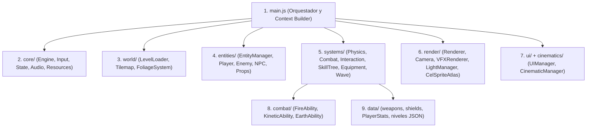
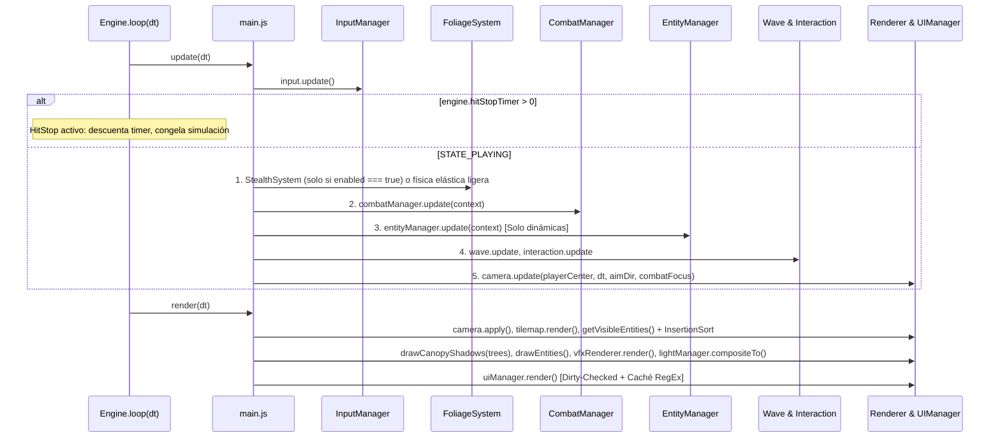

# 🏛️ Arquitectura del Motor y Flujo de Ejecución

> **Resumen Técnico:** Motor 2D modular desacoplado en 9 capas bajo `src/`, diseñado para 60/120 FPS estables sin pausas de Garbage Collection ni bloqueos síncronos de I/O.

---

## 1. Taxonomía de las 9 Capas del Motor



| Capa | Directorio | Archivos Clave | Responsabilidad Primaria |
| :--- | :--- | :--- | :--- |
| **1. Orquestador** | `src/` | `main.js` | Ciclo de vida principal, instanciación de subsistemas, construcción de `gameContext`, enrutamiento de inputs y cambios de escena. |
| **2. Core** | `src/core/` | `Engine.js`, `InputManager.js`, `StateManager.js`, `AudioManager.js`, `ResourceManager.js`, `ObjectPool.js` | Loop `requestAnimationFrame`, HitStop, entradas teclado/ratón/touch, bus reactivo, síntesis Web Audio y precarga de assets. |
| **3. Entidades** | `src/entities/` | `Entity.js`, `EntityManager.js`, `Player.js`, `Enemy.js`, `NPC.js`, `InteractableProp.js`, `House.js`, `Tree.js` | Objetos interactivos en el mundo con física en los pies, FSMs y etiquetas. |
| **4. Sistemas** | `src/systems/` | `CombatManager.js`, `PhysicsSystem.js`, `InteractionSystem.js`, `SkillTreeManager.js`, `EquipmentManager.js`, `WaveManager.js` | Lógica transversal pura: colisión AABB continua, cálculo de daño/parries/sinergias, radio de interacción `[E]`, árboles de progresión y oleadas. |
| **5. Habilidades** | `src/combat/` | `Ability.js`, `FireAbility.js`, `KineticAbility.js`, `EarthAbility.js` | Factorías de ataques elementales que instancian descriptores de ataque en `CombatManager`. |
| **6. Mundo** | `src/world/` | `LevelLoader.js`, `Tilemap.js`, `FoliageSystem.js` | Generación e instanciación de entidades desde JSON, pre-renderizado estático de suelo y arbustos con física de resorte. |
| **7. Render** | `src/render/` | `Renderer.js`, `Camera.js`, `CelSpriteAtlas.js`, `LightManager.js`, `VFXRenderer.js`, `AnimationController.js` | Y-Sorting por base de pies, Frustum Culling, cámara lerp con screen shake, horneado Cel-Shading 2D y partículas. |
| **8. UI & Escenas** | `src/ui/`, `src/cinematics/` | `UIManager.js`, `ui.css`, `CinematicManager.js` | DOM Overlay libre de reflows con dirty-checking, HUD responsivo y secuencias cinemáticas. |
| **9. Datos** | `src/data/` | `weapons.js`, `shields.js`, `PlayerStats.js`, `assets.json`, `levels/*.json` | Catálogos data-driven desacoplados del código fuente de simulación. |

---

## 2. Inyección Unificada: El Patrón `gameContext`

Para evitar importaciones circulares y variables globales descontroladas, todo el flujo de actualización y renderizado se comunica mediante un único objeto inyectado en cada fotograma (`main.js` -> `buildGameContext(deltaTime)`):

```js
// Estructura inyectada en update(context), takeDamage(..., context), interact(..., context):
const context = {
  deltaTime,           // Tiempo transcurrido en segundos acotado (máx 0.1s)
  input,               // Instancia de InputManager
  state,               // Instancia de StateManager (bus global)
  physics,             // Instancia de PhysicsSystem
  player,              // Referencia a la entidad Player
  camera,              // Instancia de Camera (worldToScreen, shake)
  entityManager,       // Gestor de entidades activas
  combatManager,       // Gestor de proyectiles, tajos y daño
  equipmentManager,    // Armas y escudos activos
  skillTreeManager,    // Progresión y talentos desbloqueados
  waveManager,         // Control de rondas y oleadas de combate
  audioManager,        // Síntesis de efectos sonoros Web Audio
  vfxRenderer,         // Emisor de partículas e impactos
  uiManager,           // Gestor del DOM Overlay
  engine,              // Motor (hitStop, pause)
  time,                // Tiempo total transcurrido
  ctx                  // Contexto 2D del canvas principal
};
```

> [!TIP]
> **Regla Defensiva:** Cualquier invocación a subsistemas opcionales debe protegerse defensivamente:
> `if (context && context.audioManager) context.audioManager.playSwordHit();`
> Esto permite testear entidades y sistemas de combate de forma aislada sin requerir el navegador completo.

---

## 3. Patrones de Rendimiento Anti-GC (Zero-Alloc Hot-Paths)

En un Action-RPG a 60/120 FPS, instanciar objetos en bucles críticos genera caídas bruscas de fotogramas por Garbage Collection. El motor impone reglas estrictas en CPU y GPU/Canvas:

1. **Contexto Persistente (`_gameContext`):**
   `buildGameContext(deltaTime)` en `main.js` actualiza en sitio un único objeto persistente prealocado en lugar de crear un diccionario de 17 propiedades en cada fotograma.
2. **Reutilización de Hitbox (`_hitboxCache`):**
   `Entity.getHitbox()` muta y devuelve su propio objeto prealocado `this._hitboxCache`. **Nunca** guardes la referencia devuelta en colecciones permanentes; lee sus campos inmediatamente (`x`, `y`, `width`, `height`).
3. **Buffer Y-Sort Filtrado (`_sortedBuffer` + `_sortY`):**
   `EntityManager.getEntities()` mantiene un buffer persistente que excluye colisionadores invisibles (`terrain_barrier`) mediante `_bufferDirty`, y precalcula `e._sortY` en $O(N)$ antes de ordenar para reducir comparaciones en `.sort()`.
4. **Caché de Sólidos e Invalidation:**
   `EntityManager.getSolids()` mantiene un arreglo `this._solidsCache`. Solo se recalcula cuando se agrega, remueve o destruye una entidad (`this._solidsCache = null`).
5. **Pasada de Suelo Pre-Entidades y Sprites Pre-horneados:**
   `Renderer.drawEnemyGroundDecals()` dibuja los conos de visión enemigos en la capa del suelo con *Frustum Culling* antes de las sombras de dosel y de los cuerpos Y-Sort, evitando solapamientos sobre arbustos y personajes. Cada entidad dibuja su propia sombra pixel-art sin duplicación genérica y `CelSpriteAtlas.prewarm()` pre-hornea todos los sprites de los 4 biomas al iniciar.
6. **Pools de Objetos Dedicados:**
   * Las estelas fantasma del dash del jugador usan `_ghostPool` con técnica *swap-and-pop*.
   * Las partículas de `VFXRenderer` se extraen de pools preinicializados.
   * La deduplicación de impactos usa colecciones reutilizables.

---

## 4. Máquina de Estados y Bus Reactivo (`StateManager`)

`src/core/StateManager.js` actúa como el bus de eventos desacoplado del juego:

### Estados Globales del Juego (`game_state`)
* `'STATE_MENU'`: Menú principal visible; no se actualiza la física del mundo.
* `'STATE_CINEMATIC'`: Cinemáticas de introducción o diálogos de historia activos.
* `'STATE_PLAYING'`: Bucle completo de juego activo.
* `'STATE_PAUSED'`: Menú de pausa o Santuario del Guantelete abierto.

### API del Bus de Eventos
* `stateManager.on(eventName, callback)`: Suscribe un observador.
* `stateManager.off(eventName, callback)`: Desuscribe un observador.
* `stateManager.emit(eventName, data)`: Notifica a todos los escuchas.
* `stateManager.set(key, value)`: Actualiza una propiedad del estado y emite `state_change` y `state_change:${key}`.
* `stateManager.get(key, defaultValue)`: Consulta el estado centralizado.

---

## 5. El Game Loop (`Engine.js` y `main.js`)

En cada fotograma ejecutado por `requestAnimationFrame`:



---

## 6. Actualización Táctica v2.1.0 (Resolución de Feedback y Pulido de Experiencia Móvil/Gameplay)

### 6.1. Desaturación y Escalado Responsivo de UI (`ui.css`, `index.html`)
- **HUD Jugador**: Escalado a `0.72` en modo táctil y `0.70` en pantallas compactas/horizontales (`max-height: 540px`). Ocultamiento automático de atajos de teclado (`.essence-hotkey`, `.st-nav-key`) en móvil.
- **Cluster Táctil de Acciones**: Botón `#touch-btn-skill` (`68x68 px`) reespaciado para evitar solapamiento de los iconos direccionales sobre **`FUEGO`**; `#touch-btn-stealth` oculto por defecto salvo en secciones de sigilo.
- **Joystick Virtual**: Escalado a `0.80` con caché del `DOMRect` en `InputManager.js` (cero reflows en `touchmove`).

### 6.2. Riberas y Colisiones de Agua (`Tilemap.js` y `PhysicsSystem.js`)
- **Visual**: Transición orgánica de 3 capas sin costuras discontinuas en los ríos.
- **Física Estricta**: Bloqueo total de `tile === 3` (agua) y `tile === 2` (acantilados) con broadphase espacial AABB para descartar obstáculos lejanos en `O(1)`.

### 6.3. Calibración Cinemática y Recurso Táctico (`PlayerStats.js`, `Player.js`, `weapons.js`)
- **Velocidad de Movimiento**: Ajustada a `190 px/s` (`dash_speed: 400`) para desplazamiento ágil y sin pesadez.
- **Regeneración de Energía**: Mantenida en `2.2/s` pasivo y `2/4` por golpe para conservar el balance táctico.

### 6.4. Progresión de Inventario y Armas Bloqueadas (`EquipmentManager.js` y `UIManager.js`)
- El jugador inicia únicamente con `training_sword` y `wooden_shield` desbloqueados; el equipamiento superior figura bloqueado (`BLOQUEADA`) hasta su progreso correspondiente.

### 6.5. Localización Adaptativa de Prompts Móvil (`textFormatter.js`, `UIManager.js`, `NPC.js`, `InteractableProp.js`)
- Reglas ordenadas de mayor a menor especificidad (frases `"Pulsa [...]"` antes que `[...]`), soporte de `[Shift]` y `[1][2][3]`, badges del canvas adaptados (`USAR · ...` en móvil) y caché O(1) en `UIManager` para no ejecutar RegEx en cada frame.

---

## 7. Optimizaciones de Rendimiento y Archivo de Sigilo v2.2.0

### 7.1. Módulo Opcional Compacto `StealthSystem.js` (Desactivado por Defecto)
- Toda la lógica de detección por cono de visión, ocultación en grama alta y viñeta de amenaza en esquinas fue extraída a [`StealthSystem.js`](file:///c:/Users/user/Desktop/video%20proyectos/Be%20a%20legend/src/systems/StealthSystem.js) con **`enabled = false` por defecto**.
- Para reactivarlo únicamente en escenas específicas, basta definir `"enableStealth": true` en el JSON del nivel o invocar `stealthSystem.setEnabled(true, stateManager, player)`. Cuando está activo, usa un cono compacto reducido (`112 px`, `60°`) con comprobación dosificada (`~8 Hz`) y sin trazar rayos sobre enemigos fuera de rango.

### 7.2. Pipeline Gráfico de Canvas Único y Bucle O(1)
- **Resolución Pixel-Art Nativa (`Camera.getOptimalCanvasSize`) + Un Solo Canvas Opaco (`{ alpha: false }`)**: `#main-canvas` renderiza en escala entera compacta y `#light-canvas` opera como buffer offscreen ligero (`<= 320x180`) compuesto directamente vía `lightManager.compositeTo()`, eliminando la doble capa GPU del navegador y liberando `~4x–9x` fill-rate.
- **Caché de Entidades y Culling Previo**: `EntityManager` separa estructuras estáticas (`tree`, `house`, `terrain_barrier`), indexa etiquetas invariantes en cubetas persistentes y ordena por Y-Sort **después** del recorte de cámara usando Insertion Sort in-place.
- **Gestión de Memoria Cinemática (`CinematicManager`)**: Pre-carga inicial de solo 2 diapositivas y liberación automática (`releaseCache()`) de imágenes 4K al iniciar el gameplay, además de eliminar `backdrop-filter: blur(18px)` del menú principal.

---

## 8. Compresión de RAM, Streaming por Chunks y Cero Refresco Ocioso v3.0.0

### 8.1. Patrón Flyweight para Texturas Repetidas (`ProceduralAssets`, `ResourceManager`, `Tilemap`, `CelSpriteAtlas`)
- **Canvas Flyweight Directo**: `ProceduralAssets.getSharedCanvas()` hornea y cachea una única vez cada textura repetitiva (`tree_sprite`, `house_sprite`, `bush_sprite`) sin pasar por codificación/decodificación base64 PNG; `ResourceManager` guarda la referencia compartida única para todas las instancias en escena.
- **Sellos de Loseta por Bioma (`Tilemap`)**: Se pre-hornean solo ~14 losetas base de `32x32` por bioma (`turf_0..3`, `dirt_0..3`, `water_0..3`, `cliff_0..1`, `plaza_0..1`) que se estampan con `drawImage()` en lugar de repintar o mantener un lienzo gigante completo de mundo en RAM.
- **Atlas LRU Bajo Demanda (`CelSpriteAtlas`)**: Se elimina el pre-horneado masivo de ~190 sprites en el arranque; cada variante se genera bajo demanda con un tope LRU (`MAX_CACHED_SPRITES = 56`) y `clear()` al cambiar de bioma.

### 8.2. Carga Espacial por Chunks con Memoria Persistente (`ChunkManager.js` + `Tilemap.js`)
- **Terreno por Chunks (`Tilemap` `256x256 px`, LRU máx. 18 chunks)**: Solo los chunks visibles en cámara se hornean y mantienen en memoria gráfica, liberando (`width = height = 0`) los más antiguos.
- **Entidades por Chunks con Persistencia (`ChunkManager`)**: `LevelLoader` registra planos ligeros agrupados en chunks de `256x256 px` e instancia entidades únicamente en la vecindad de la cámara con histéresis de descarga.
- **Memoria de Estado (`serializeChunkState` / `restoreChunkState`)**: Al descargar un chunk frío, `Enemy`, `InteractableProp` y `NPC` guardan un snapshot compacto en `ChunkManager.entityMemory` (enemigos derrotados, tiempo restante de reaparición calculado por reloj, escudos de madera quemados, zarzas/rocas destruidas, espada recogida y progreso de rescate de Valerio).

### 8.3. Campo de Agresividad Enemigo Acotado (`Enemy.js`)
- Radios `aggroRange` reducidos (`hound: 136`, `tank: 128`, `duelist: 148`, `artillery: 164`, `slime: 120`), umbral de reposo en IA (`340 px`) y correa territorial (`200 px`) con pérdida de aggro en `2.0 s` fuera de rango (manteniendo cobertura en arena para `wave_enemy`).

### 8.4. Carga Perezosa de Menús y Cero Bucles Innecesarios (`Engine.js`, `main.js`, `UIManager.js`, `ui.css`)
- **Cero Bucle Ocioso (`Engine.js`)**: `engine.pause()` cancela el `requestAnimationFrame` pendiente en lugar de seguir refrescando 60/120 veces por segundo; en `STATE_CINEMATIC` el bucle se pausa automáticamente al terminar el efecto máquina de escribir hasta la siguiente interacción (`onWake`), y la pestaña oculta (`visibilitychange`) detiene el bucle.
- **Carga Perezosa de Mundo, Cinemáticas y Menús**: Al iniciar en `#main-menu` NO se pre-cargan cinemáticas, entidades, sprites ni el Santuario. Al salir del menú se libera `cover.jpg` (`.menu-cover-active`), `UIManager.unmountSanctuary()` limpia el DOM/texturas del Santuario al cerrarlo (`menu_sanctuary_bg.jpg`, `skill_combat_preview.jpg`), `LightManager` limita re-horneados a `~30 Hz`, y `.hidden *` pausa animaciones CSS.

---

## 9. Optimización de Datos, Cero-GC y Rejilla Espacial v4.0.0 (Fases 0–3)

### 9.1. Telemetría Condicional (`PerfOverlay.js`)
- [`PerfOverlay`](file:///c:/Users/user/Desktop/video%20proyectos/Be%20a%20legend/src/render/PerfOverlay.js) renderiza FPS, ms de `update`/`render`, chunks activos/recordados y caché de sprites a ~4 Hz únicamente cuando `window.DEBUG_MODE === true`.

### 9.2. Compresión de Imágenes y Limpieza de `public/assets`
- Cinemáticas y `cover.jpg` reescaladas de `2752x1536` a `1280x720` (calidad 82, `-78%` de RAM decodificada), `menu_sanctuary_bg.jpg` a `960x536`, `skill_combat_preview.jpg` a `640x358`, `gauntlet_crest.jpg` de `1024x1024` a `128x128` (`5.4 KB`), y decodificación asíncrona con `img.decode()` en `CinematicManager`.
- Assets sin referencias movidos fuera de `public/` a `_assets_backup/unused/` (y originales respaldados en `_assets_backup/originals/`).

### 9.3. Cero Asignaciones por Frame (`StateManager`, `Entity`, `EntityManager`, `CombatManager`, `InteractionSystem`, `CelSpriteAtlas`)
- `StateManager.set()` aplica dirty-check (`===`) y cachea nombres `${key}_changed` sin emitir cuando el valor no cambia.
- `Entity.hasTag()` consulta un `Set` sincronizado en O(1) en lugar de `Array.includes`.
- `EntityManager.removeEntity()` usa swap-and-pop O(1) sin `Array.splice`.
- `CombatManager` reutiliza `_activeThreatCache` y aplica dirty-check en `_syncComboState()`; `InteractionSystem` evita `concat()`; `CelSpriteAtlas` marca `_lastUse` en O(1) sin `delete+set` en cada frame.

### 9.4. Rejilla Espacial Hash (`SpatialGrid.js`)
- [`SpatialGrid`](file:///c:/Users/user/Desktop/video%20proyectos/Be%20a%20legend/src/world/SpatialGrid.js) indexa entidades y sólidos por celdas de `128 px` con claves enteras empaquetadas y buffers reutilizables (`queryBounds`) en `PhysicsSystem`, `Enemy` (separación) y `CombatManager` (colisiones de ataques).

---

## 10. Escalabilidad Multi-Escenario, Pool de Proyectiles, Slide/Dive, Sigilo v2 y Minimapa v5.0

> **Principio rector:** Ningún subsistema importa directamente las clases concretas de otros subsistemas; el orquestador [`main.js`](file:///c:/Users/user/Desktop/video%20proyectos/Be%20a%20legend/src/main.js) calcula una sola vez los datos compartidos del fotograma (`_playerCenterCache`, `visibleBounds`, `surfaceSlideFactor`, `lightFactor`, `enemy._lastPlayerDistSq`) y los recicla mediante escalares y callbacks planos Zero-GC.

### 10.1. Carga Dinámica de Mundos y Persistencia Desacoplada (`worlds.js`, `WorldMemoryStore.js`, `ChunkManager.js`)
- `WORLDS_CATALOG` conserva únicamente metadatos ligeros en el bundle inicial; [`loadWorldData(worldKey, evictOthers)`](file:///c:/Users/user/Desktop/video%20proyectos/Be%20a%20legend/src/data/worlds.js) importa bajo demanda el JSON del bioma activo (`import('./levels/${worldKey}.json')` nativo de Vite/ESM sin atributos MIME incompatibles en dev) y libera referencias de escenarios previos con `releaseWorldData()`.
- [`WorldMemoryStore`](file:///c:/Users/user/Desktop/video%20proyectos/Be%20a%20legend/src/world/WorldMemoryStore.js) preserva snapshots compactos (`ChunkManager.exportMemory()` / `importMemory()`) y máscaras de Niebla de Guerra (`Uint32Array`, ~64 bytes/mundo) al viajar entre mundos sin retener nodos ni texturas inactivas en RAM.

### 10.2. Pool de Proyectiles Zero-GC y Batching Flyweight (`ProjectileSystem.js`, `CelSpriteAtlas.js`)
- [`ProjectileSystem`](file:///c:/Users/user/Desktop/video%20proyectos/Be%20a%20legend/src/systems/ProjectileSystem.js) gestiona hasta **192 proyectiles simultáneos** con ranuras planas reutilizables (*swap-and-pop*), detección O(1) de proyectiles hostiles contra `playerTarget`, rechazo rápido de hitos estáticos y renderizado en un único lote desde sprites horneados (`CelSpriteAtlas.getProjectileSprite()`).
- Soporte nativo de altura (`altitude: 'high' | 'low'`): los proyectiles altos pasan sobre el jugador cuando `player.lowProfile === true` y disparan `onLowEvadeFn` (`¡ESQUIVA BAJA!`). Integrado de forma opcional (con fallback a `CombatManager`) en [`FireAbility.js`](file:///c:/Users/user/Desktop/video%20proyectos/Be%20a%20legend/src/combat/FireAbility.js), [`Enemy.js`](file:///c:/Users/user/Desktop/video%20proyectos/Be%20a%20legend/src/entities/Enemy.js), [`Player.js`](file:///c:/Users/user/Desktop/video%20proyectos/Be%20a%20legend/src/entities/Player.js) (`bladeWave`) y [`CombatManager.js`](file:///c:/Users/user/Desktop/video%20proyectos/Be%20a%20legend/src/systems/CombatManager.js) (`mirror_ricochet`).

### 10.3. Maniobras de Perfil Bajo Compartidas: Slide y Dive (`Player.js`, `Tilemap.js`, `PlayerStats.js`)
- [`Player._startBurstMotion()`](file:///c:/Users/user/Desktop/video%20proyectos/Be%20a%20legend/src/entities/Player.js) unifica **`STATE_DASH`**, **`STATE_SLIDE`** (`[C]` / botón móvil `BAJAR` al correr o cancelar dash) y **`STATE_DIVE`** (`[Espacio]` / botón `ESQUIVAR` estando agachado o deslizando) reutilizando el mismo temporizador, vector de impulso, pool de estelas fantasma y **Slide-Strike** cuerpo a cuerpo.
- `Tilemap.getSurfaceSlideFactor(tileId, biomeKey)` entrega un escalar plano en `gameContext.surfaceSlideFactor` para modular fricción/alcance en piedra pulida, madera, musgo húmedo o ceniza sin acoplar `Player` con `Tilemap`.

### 10.4. Sigilo Modular v2: Zonas, Sospecha Gradual y Eventos de Ruido (`StealthSystem.js`)
- [`StealthSystem`](file:///c:/Users/user/Desktop/video%20proyectos/Be%20a%20legend/src/systems/StealthSystem.js) soporta activación global o por zonas AABB (`setZones` / `evaluateZoneAt`) sin bloquear `player.isProne` / `lowProfile` fuera de zona.
- Acumula `enemy.suspicion` (`0..100`) reciclando `enemy._lastPlayerDistSq`, el perfil bajo (`player.lowProfile`) y el escalar lumínico (`samplePlayerLightFactor` en `main.js`), responde a pulsos puntuales (`emitNoise` sin polling ocioso) y dibuja conos Flyweight (`cone_patrol` / `cone_alert`) vía callback.

### 10.5. Audio WebAudio Resiliente y Optimización de Entidades
- `SpatialGrid.updateEntity()` descarta en O(1) entidades inmóviles comparando coordenadas previas (`_sgLx` / `_sgLy`) y `CelSpriteAtlas.MAX_CACHED_SPRITES = 160` evita desalojos y lecturas `getImageData` GPU->CPU durante combates intensos; `LightManager` limita re-horneados a ~30 Hz salvo saltos de cámara `>= 14 px`.
- [`AudioManager`](file:///c:/Users/user/Desktop/video%20proyectos/Be%20a%20legend/src/core/AudioManager.js) bloquea la inicialización prematura fuera de gesto de usuario, escucha `statechange` + promesas `.resume().then()` en `pointerdown`/`mousedown`/`click`/`touchend`/`keydown` para activar automáticamente la ambientación del bioma y SFX en Firefox/Chrome sin descartarlos por estado `'suspended'`, y acota el filtro paso-bajo al Nyquist real del hardware (`sampleRate * 0.45`).

---

## 11. Forja de Mundos: Creador y Editor Visual de Niveles v1.0.0 (`src/editor/`)

> **Objetivo:** Permitir la creación, edición visual, guardado, exportación/importación `.json` y prueba instantánea (*Playtest*) de niveles 100% compatibles con el esquema JSON canónico del motor, sin dependencias circulares y sin impacto de RAM o CPU durante la partida normal.

### 11.1. Principios de Cero Sobrecarga (Lazy Import & Render Bajo Demanda)
- **Carga Perezosa (0 KB en arranque):** El módulo del editor (`src/editor/*`) no forma parte del bundle principal de arranque. Solo se importa mediante `await import('./editor/LevelEditor.js')` cuando el jugador hace clic en el botón periférico **"FORJA DE NIVELES"** de la Pantalla de Título. En el build de producción se empaqueta como un chunk aislado (`dist/assets/LevelEditor-*.js`).
- **Renderizado Bajo Demanda (0 FPS en reposo):** No ejecuta ningún bucle continuo de `requestAnimationFrame` mientras el usuario no interactúa. Solo redibuja un fotograma cuando se produce una acción (pincelada, pan, zoom, selección o edición de inspector).
- **Desacoplamiento Estricto:** El editor nunca instancia `CombatManager`, `Player` físico ni `PhysicsSystem`. Opera sobre un objeto plano `levelDraft` que respeta el contrato exacto de [`LevelLoader.js`](file:///c:/Users/user/Desktop/video%20proyectos/Be%20a%20legend/src/world/LevelLoader.js).

### 11.2. Módulos del Editor (`src/editor/`)
1. **[`EditorCatalog.js`](file:///c:/Users/user/Desktop/video%20proyectos/Be%20a%20legend/src/editor/EditorCatalog.js):** Metadatos puros de paletas:
   - **Terreno:** IDs canónicos `0..5` (Césped concatenable `turf_0..7`, Sendero `dirt_0..3`, Acantilado `cliff_0..3` con bloques facetados y musgo, Agua/Magma `water_0..3`, Puente, Plaza `plaza_0..1` en aparejo trabado). Texturas independientes exportadas en `public/assets/environment/`.
   - **Props:** 13 tipos canónicos + **`custom_env_prop` (Objeto de Ambiente Personalizado)** con soporte de textura personalizada (`textureUrl`), dimensiones dinámicas (`16–384 px`), descripción funcional (`devDescription`), clave técnica (`customKey`) y plantillas reutilizables en `localStorage` (`be_a_legend_custom_props_v1`).
   - **Estructuras:** Árbol, Arbusto y Casa.
   - **Actores:** `playerSpawn`, `arenaCenter`, NPCs (`tarak`, `valerio`), Enemigos dinámicos consumidos de `ENEMY_ARCHETYPES`.
   - **Zonas y Luces:** `solidColliders` (AABB), `stealthZones` (AABB) y `lights` (puntos de luz rúnica con radio/color).
2. **[`LevelSerializer.js`](file:///c:/Users/user/Desktop/video%20proyectos/Be%20a%20legend/src/editor/LevelSerializer.js):**
   - **Compresión RLE:** Codifica `terrainGrid` en cadenas Run-Length compactas (`"0x12,1x4,2x3"`), reduciendo el consumo en `localStorage` (`be_a_legend_custom_levels_v1`) de ~25 KB a ~250 bytes por nivel.
   - **Validación Pre-Vuelo:** Detecta spawn fuera de límites o sobre acantilados/agua, emite avisos útiles y garantiza integridad estructural.
   - **Exportación / Importación:** Descarga y lectura de archivos `.json` compatibles con `LevelLoader`.
3. **[`EditorHistory.js`](file:///c:/Users/user/Desktop/video%20proyectos/Be%20a%20legend/src/editor/EditorHistory.js):**
   - Historial de Deshacer / Rehacer de 40 pasos basado en deltas mínimos (`tile_stroke`, `item_add`, `item_remove`, `item_move`, `spawn_move`), sin clonar mapas completos en memoria.
4. **[`LevelEditor.js`](file:///c:/Users/user/Desktop/video%20proyectos/Be%20a%20legend/src/editor/LevelEditor.js):**
   - Lienzo interactivo con Pan (botón central/derecho/espacio), Zoom discreto (rueda del ratón / botones), brochas de terreno (`1x1`, `3x3`, `Rectángulo`, `Bote de pintura BFS`), selección y arrastre de objetos con Snap (`32px`, `16px`, `Libre`), e inspector contextual.

### 11.3. Horneado Incremental del Terreno (`Tilemap.js`)
- `Tilemap.prototype.setTileAndInvalidate(col, row, tileId)` modifica la celda de la grilla lógica y desaloja del caché `_chunkCache` **únicamente el chunk editado y sus vecinos inmediatos (3x3)** afectados por Dual-Grid y voladizos de gabinete, eliminando la necesidad de reconstruir el mapa entero durante la edición.

### 11.4. Puente de Playtest en 1 Clic y Retorno Instantáneo
- Al presionar **"▶ PROBAR"** (o `F5`):
  1. `LevelValidator` comprueba la viabilidad del nivel.
  2. `registerCustomWorld()` en [`worlds.js`](file:///c:/Users/user/Desktop/video%20proyectos/Be%20a%20legend/src/data/worlds.js) inyecta el borrador en memoria bajo el ID `__editor_playtest__`.
  3. El editor oculta su capa visual preservando la posición de cámara y la pila Undo/Redo en RAM.
  4. El motor carga el nivel con `loadWorld('__editor_playtest__')` y muestra el botón flotante **"⏹ VOLVER AL EDITOR"** en el HUD superior (`F9`).
- Al pulsar **"⏹ VOLVER AL EDITOR"**:
  1. Se purgan los estados de combate y proyectiles.
  2. El editor restaura su interfaz exactamente en el estado en que se dejó.


