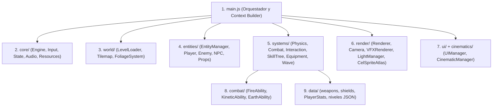
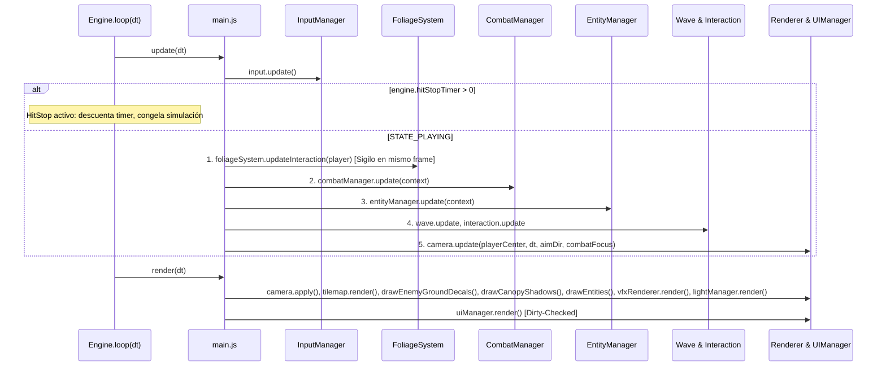

# 🏛️ Arquitectura del Motor y Flujo de Ejecución

> **Resumen Técnico:** Motor 2D modular desacoplado en 9 capas bajo `src/`, diseñado para 60/120 FPS estables sin pausas de Garbage Collection ni bloqueos síncronos de I/O.

---

## 1. Taxonomía de las 9 Capas del Motor



| Capa | Directorio | Archivos Clave | Responsabilidad Primaria |
| :--- | :--- | :--- | :--- |
| **1. Orquestador** | `src/` | `main.js` | Ciclo de vida principal, instanciación de subsistemas, construcción de `gameContext`, enrutamiento de inputs y cambios de escena. |
| **2. Core** | `src/core/` | `Engine.js`, `InputManager.js`, `StateManager.js`, `AudioManager.js`, `ResourceManager.js`, `ObjectPool.js` | Loop `requestAnimationFrame`, HitStop, entradas teclado/ratón/touch, bus reactivo, síntesis Web Audio y precarga de assets. |
| **3. Entidades** | `src/entities/` | `Entity.js`, `EntityManager.js`, `Player.js`, `Enemy.js`, `NPC.js`, `InteractableProp.js`, `House.js`, `Tree.js` | Objetos interactivos en el mundo con física en los pies, FSMs y etiquetas. |
| **4. Sistemas** | `src/systems/` | `CombatManager.js`, `PhysicsSystem.js`, `InteractionSystem.js`, `SkillTreeManager.js`, `EquipmentManager.js`, `WaveManager.js` | Lógica transversal pura: colisión AABB continua, cálculo de daño/parries/sinergias, radio de interacción `[E]`, árboles de progresión y oleadas. |
| **5. Habilidades** | `src/combat/` | `Ability.js`, `FireAbility.js`, `KineticAbility.js`, `EarthAbility.js` | Factorías de ataques elementales que instancian descriptores de ataque en `CombatManager`. |
| **6. Mundo** | `src/world/` | `LevelLoader.js`, `Tilemap.js`, `FoliageSystem.js` | Generación e instanciación de entidades desde JSON, pre-renderizado estático de suelo y arbustos con física de resorte. |
| **7. Render** | `src/render/` | `Renderer.js`, `Camera.js`, `CelSpriteAtlas.js`, `LightManager.js`, `VFXRenderer.js`, `AnimationController.js` | Y-Sorting por base de pies, Frustum Culling, cámara lerp con screen shake, horneado Cel-Shading 2D y partículas. |
| **8. UI & Escenas** | `src/ui/`, `src/cinematics/` | `UIManager.js`, `ui.css`, `CinematicManager.js` | DOM Overlay libre de reflows con dirty-checking, HUD responsivo y secuencias cinemáticas. |
| **9. Datos** | `src/data/` | `weapons.js`, `shields.js`, `PlayerStats.js`, `assets.json`, `levels/*.json` | Catálogos data-driven desacoplados del código fuente de simulación. |

---

## 2. Inyección Unificada: El Patrón `gameContext`

Para evitar importaciones circulares y variables globales descontroladas, todo el flujo de actualización y renderizado se comunica mediante un único objeto inyectado en cada fotograma (`main.js` -> `buildGameContext(deltaTime)`):

```js
// Estructura inyectada en update(context), takeDamage(..., context), interact(..., context):
const context = {
  deltaTime,           // Tiempo transcurrido en segundos acotado (máx 0.1s)
  input,               // Instancia de InputManager
  state,               // Instancia de StateManager (bus global)
  physics,             // Instancia de PhysicsSystem
  player,              // Referencia a la entidad Player
  camera,              // Instancia de Camera (worldToScreen, shake)
  entityManager,       // Gestor de entidades activas
  combatManager,       // Gestor de proyectiles, tajos y daño
  equipmentManager,    // Armas y escudos activos
  skillTreeManager,    // Progresión y talentos desbloqueados
  waveManager,         // Control de rondas y oleadas de combate
  audioManager,        // Síntesis de efectos sonoros Web Audio
  vfxRenderer,         // Emisor de partículas e impactos
  uiManager,           // Gestor del DOM Overlay
  engine,              // Motor (hitStop, pause)
  time,                // Tiempo total transcurrido
  ctx                  // Contexto 2D del canvas principal
};
```

> [!TIP]
> **Regla Defensiva:** Cualquier invocación a subsistemas opcionales debe protegerse defensivamente:
> `if (context && context.audioManager) context.audioManager.playSwordHit();`
> Esto permite testear entidades y sistemas de combate de forma aislada sin requerir el navegador completo.

---

## 3. Patrones de Rendimiento Anti-GC (Zero-Alloc Hot-Paths)

En un Action-RPG a 60/120 FPS, instanciar objetos en bucles críticos genera caídas bruscas de fotogramas por Garbage Collection. El motor impone reglas estrictas en CPU y GPU/Canvas:

1. **Contexto Persistente (`_gameContext`):**
   `buildGameContext(deltaTime)` en `main.js` actualiza en sitio un único objeto persistente prealocado en lugar de crear un diccionario de 17 propiedades en cada fotograma.
2. **Reutilización de Hitbox (`_hitboxCache`):**
   `Entity.getHitbox()` muta y devuelve su propio objeto prealocado `this._hitboxCache`. **Nunca** guardes la referencia devuelta en colecciones permanentes; lee sus campos inmediatamente (`x`, `y`, `width`, `height`).
3. **Buffer Y-Sort Filtrado (`_sortedBuffer` + `_sortY`):**
   `EntityManager.getEntities()` mantiene un buffer persistente que excluye colisionadores invisibles (`terrain_barrier`) mediante `_bufferDirty`, y precalcula `e._sortY` en $O(N)$ antes de ordenar para reducir comparaciones en `.sort()`.
4. **Caché de Sólidos e Invalidation:**
   `EntityManager.getSolids()` mantiene un arreglo `this._solidsCache`. Solo se recalcula cuando se agrega, remueve o destruye una entidad (`this._solidsCache = null`).
5. **Pasada de Suelo Pre-Entidades y Sprites Pre-horneados:**
   `Renderer.drawEnemyGroundDecals()` dibuja los conos de visión enemigos en la capa del suelo con *Frustum Culling* antes de las sombras de dosel y de los cuerpos Y-Sort, evitando solapamientos sobre arbustos y personajes. Cada entidad dibuja su propia sombra pixel-art sin duplicación genérica y `CelSpriteAtlas.prewarm()` pre-hornea todos los sprites de los 4 biomas al iniciar.
6. **Pools de Objetos Dedicados:**
   * Las estelas fantasma del dash del jugador usan `_ghostPool` con técnica *swap-and-pop*.
   * Las partículas de `VFXRenderer` se extraen de pools preinicializados.
   * La deduplicación de impactos usa colecciones reutilizables.

---

## 4. Máquina de Estados y Bus Reactivo (`StateManager`)

`src/core/StateManager.js` actúa como el bus de eventos desacoplado del juego:

### Estados Globales del Juego (`game_state`)
* `'STATE_MENU'`: Menú principal visible; no se actualiza la física del mundo.
* `'STATE_CINEMATIC'`: Cinemáticas de introducción o diálogos de historia activos.
* `'STATE_PLAYING'`: Bucle completo de juego activo.
* `'STATE_PAUSED'`: Menú de pausa o Santuario del Guantelete abierto.

### API del Bus de Eventos
* `stateManager.on(eventName, callback)`: Suscribe un observador.
* `stateManager.off(eventName, callback)`: Desuscribe un observador.
* `stateManager.emit(eventName, data)`: Notifica a todos los escuchas.
* `stateManager.set(key, value)`: Actualiza una propiedad del estado y emite `state_change` y `state_change:${key}`.
* `stateManager.get(key, defaultValue)`: Consulta el estado centralizado.

---

## 5. El Game Loop (`Engine.js` y `main.js`)

En cada fotograma ejecutado por `requestAnimationFrame`:



---

## 6. Actualización Táctica v2.1.0 (Resolución de Feedback y Pulido de Experiencia Móvil/Gameplay)

### 6.1. Desaturación y Escalado Responsivo de UI (`ui.css`)
- **HUD Jugador**: Escalado a `0.72` en modo táctil y `0.70` en pantallas compactas/horizontales (`max-height: 540px`).
- **Cluster Táctil de Acciones**: Compactado a `0.78` de escala y reubicado en la esquina inferior derecha para liberar visibilidad de combate y exploración.
- **Joystick Virtual**: Escalado a `0.80` con zona de toque optimizada.
- **Banner de Victoria y Anuncios**: Reposicionado a `top: calc(var(--safe-top) + 48px)` con tipografía compacta, evitando tapar el avatar del héroe en el centro de la pantalla.

### 6.2. Riberas y Colisiones de Agua (`Tilemap.js` y `PhysicsSystem.js`)
- **Visual**: Supresión de patrones rectangulares discontinuos (`- - -`) en los bordes de los ríos. Transición orgánica de 3 capas: borde rocoso oscuro (`#182130`), lecho húmedo (`pal.dirtDark`) y profundidad acuática (`pal.waterDeep`).
- **Física Estricta**: Eliminación del bypass que permitía atravesar losetas de agua (`tile === 3`) o precipicios (`tile === 2`). El puente (`tile === 4`) se preserva como la única vía de cruce válida sobre el cauce.

### 6.3. Calibración Cinemática y Recurso Táctico (`PlayerStats.js`, `Player.js`, `weapons.js`)
- **Velocidad de Movimiento**: Ajustada de `215 px/s` a `155 px/s` (caminata) y multiplicador de sprint regulado a `1.36` (anteriormente `1.62`), logrando control preciso en grillas de 32 px.
- **Regeneración de Energía**: Reducida de `6.0/s` a `2.2/s` pasivo y de `6/10` a `2/4` por golpe exitoso, convirtiendo las habilidades elementales en recursos tácticos medidos y valiosos.

### 6.4. Progresión de Inventario y Armas Bloqueadas (`EquipmentManager.js` y `UIManager.js`)
- Implementación de un registro de desbloqueo (`unlockedWeapons`, `unlockedShields`).
- El jugador inicia únicamente con la `training_sword` y el `wooden_shield`.
- Armas de nivel superior (ej. `relic_blade`, `iron_pavise`) se muestran bloqueadas (`🔒 BLOQUEADA`) en el Arsenal del Santuario hasta su descubrimiento formal.

### 6.5. Localización Adaptativa de Prompts Móvil (`textFormatter.js`)
- Sustitución dinámica de atajos de teclado (`[Clic Izq / J]`, `[Clic Der / K]`, `[E]`, `[Espacio]`, etc.) por nombres de botones virtuales (`(botón ESPADA)`, `(botón FUEGO)`, `(botón USAR)`, `(botón DASH)`) cuando se detecta un dispositivo móvil o controles táctiles activos.

