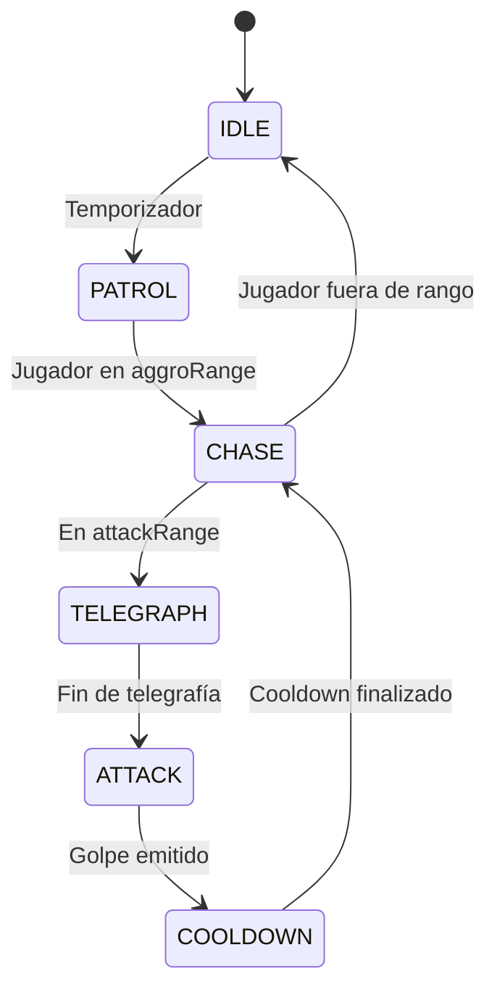

# ⚔️ Sistema de Combate, Entidades e Inteligencia Artificial

> **Resumen Técnico:** Sistema de combate fluido y de alto impacto (*Push-Forward* y *Risk/Reward*), con gestión de postura, parries perfectos, combos rítmicos, IA enemiga por arquetipos y sinergias elementales reactivas.

---

## 1. El Ciclo de Vida de las Entidades (`Entity.js`)

Todas las entidades (`Player`, `Enemy`, `NPC`, `InteractableProp`, `House`, `Tree`) heredan de `Entity`.

### Hitbox y Colisiones
* **Hitbox en los Pies:** Las colisiones físicas y el Y-sorting se calculan en la base del personaje (`hitbox.offsetY`), permitiendo que las cabezas y torsos se superpongan de manera creíble a muros y follaje.
* **Cero Alocación:** `entity.getHitbox()` muta y devuelve `this._hitboxCache` sin crear `{ x, y, width, height }` nuevos.

### Etiquetas y Estados Alterados Unificados (`hasTag`)
El método `hasTag(tag)` verifica simultáneamente:
1. **Etiquetas Permanentes (`this.tags`):** `'player'`, `'enemy'`, `'solid'`, `'wooden_shield'`, `'destructible_prop'`, `'elem_fuego'`, etc.
2. **Estados Temporales (`this.activeEffects` - `Map<string, number>`):**
   * `'iframe'`: Inmunidad al daño (tras recibir golpe o durante dash).
   * `'staggered'`: Guardia rota / aturdido; recibe golpes críticos Riposte (daño x2.5).
   * `'inmovilizado_raices'`: Atrapado por raíces del elemento Tierra.
   * `'quemadura_ignea'`: Daño periódico por fuego (Tick cada 0.5s).
   * `'vitality_shield'`: Escudo rúnico que absorbe un impacto letal.

---

## 2. El Jugador: Habilidades y FSM (`Player.js`)

### Máquina de Estados del Jugador (`fsmState`)
* `'STATE_IDLE'`: En reposo, listo para moverse o iniciar acciones.
* `'STATE_WALK'`: Desplazamiento omnidireccional con *bobbing* procedural y rotación fluida.
* `'STATE_ATTACK'`: Ejecutando uno de los tajos de la cadena rítmica.
* `'STATE_DASH'`: Desplazamiento balístico a alta velocidad (420 px/s, 0.22s) con *iframes*.
* `'STATE_PARRY'`: Alza de la Égida Rúnica; ventana activa de desvío perfecto (0.16s - 0.26s).
* `'STATE_HURT'`: Breve aturdimiento tras recibir un golpe no bloqueado.
* `'STATE_STAGGERED'`: Rotura total de postura (1.8s) al agotar el *Guard Meter*.

### Mecánicas Núcleo de Combate
1. **Cadena Rítmica de 3 Golpes (Espada):**
   * *Golpe 1:* Tajo diestro rápido (`comboStep = 0`).
   * *Golpe 2:* Revés cruzado ascendente (`comboStep = 1`).
   * *Golpe 3 (Finisher):* Tajo sacro circular 360° con gran retroceso y screen shake (`comboStep = 2`).
   * *Pre-Buffer (Input Queueing):* Comandos pulsados en los últimos milisegundos se encolan en `this.queuedAction` para garantizar cero pulsaciones perdidas.
2. **Recarga Activa de Energía:** Cada tajo conectado con la espada restaura automáticamente **+6 a +10 de Energía Elemental**, forzando al jugador a alternar entre combate cuerpo a cuerpo y magia.
3. **Defensa, Guardia y Parry Deportivo:**
   * Mantener Bloqueo absorbe daño físico a costa de *Guard Meter*.
   * Si se pulsa bloqueo en los primeros **0.16s (base)** o **0.26s (con talento)** del golpe enemigo:
     * **Parry Perfecto:** 0 daño recibido, congelación de tiempo (*HitStop* de 80ms), desvío de proyectiles enemigos de vuelta a su emisor, y el enemigo entra en estado `'staggered'`.

---

## 3. Arquetipos de IA Enemiga (`Enemy.js`)

Los enemigos utilizan una Máquina de Estados Finita:
`IDLE` ➔ `PATROL` ➔ `CHASE` ➔ `TELEGRAPH` ➔ `ATTACK` ➔ `COOLDOWN`.



### Tabla de Arquetipos Data-Driven (`ENEMY_ARCHETYPES`)

| Arquetipo | Vida Base | Velocidad | Rango Ataque | Telegrafía | Daño Postura | Comportamiento Táctico |
| :--- | :--- | :--- | :--- | :--- | :--- | :--- |
| **`hound` (Sabueso de Zarzas)** | 75 HP | 112 px/s | 105 px | 0.40s | 24 | Flanqueo rápido en jauría, salto/lunge balístico a 305 px/s. |
| **`artillery` (Esporífero Artillero)** | 70 HP | 86 px/s | 250 px | 0.48s | 22 | Kiting (mantiene distancia mínima 110 px), proyectiles deflectables con Parry. |
| **`tank` (Centinela Pavés)** | 135 HP | 62 px/s | 56 px | 0.56s | 48 | Escudo de roble frontal (`wooden_shield`) que anula ataques débiles. Vulnerable a Fuego. |
| **`duelist` (Duelista Implacable)** | 110 HP | 104 px/s | 128 px | 0.42s | 32 | Esgrima con amagues orbitales, estocada relámpago a 365 px/s para castigar parries tardíos. |
| **`slime` (Babosa Primordial)** | 80 HP | 82 px/s | 76 px | 0.45s | 20 | Desplazamiento con compresión procedural; soporta `canSplit` en el Pantano de Esporas. |
| **`sentinel_ether` (Centinela de Éter)** | 115 HP | 92 px/s | 185 px | 0.46s | 26 | Kiting a media/larga distancia; dispara orbes astrales altos (`altitude: 'high'`). |
| **`boss_bramble` / `boss_spore` / `boss_forge` / `boss_astral`** | 340–520 HP | 74–108 px/s | 76–205 px | 0.44–0.58s | 34–50 | Guardianes Regionales (`44×44`, `56×56` sprite). Transicionan a **Fase II** al caer a `<= 50% HP` y liberan `worldSeal` + `bossId`. |

---

## 4. El Patrón Descriptor de Ataque (`CombatManager.js`)

Cualquier ataque (físico, mágico, proyectil o trampa) se registra llamando a:
`context.combatManager.addAttack(attackDescriptor)`

```js
// Estructura canónica de un Descriptor de Ataque:
{
  owner: 'player',                  // 'player' | 'enemy'
  element: 'fuego',                 // 'physical' | 'fuego' | 'kinetic' | 'plantas'
  damage: 24,                       // Daño numérico base
  postureDamage: 18,                // Daño al medidor de guardia/postura
  duration: 0.20,                   // Tiempo activo en segundos
  hitbox: { x, y, width, height },  // Caja de colisión en coordenadas de mundo
  destroyOnHit: false,              // true para proyectiles que mueren al impactar
  hitEntities: new Set(),           // Deduplicación automática de impactos por frame
  isFinisher: false,                // Si dispara vibración y screen shake pesado
  applyEffect: 'quemadura_ignea',    // Efecto de estado opcional a aplicar
  effectDuration: 3.0,              // Duración del efecto de estado
  update: function(dt) { ... }      // Callback opcional de movimiento por fotograma
}
```

---

## 5. Matriz de Interacciones y Sinergias Elementales

```
                 [🔥 FUEGO]
                /          \
  (Quema Escudos/Zarzas)  (Detona Raíces: Sinergia Explosiva)
              /              \
    [🌿 TIERRA / PLANTAS] ──── [⚡ CINÉTICA]
      (Inmoviliza / Absorbe)     (Reflejo / Empuje / Onda)
```

1. **🔥 Fuego vs 🌿 Tierra / Madera:**
   * **Incineración de Escudos:** Si un proyectil o ataque de fuego impacta al Centinela Pavés (`hasWoodenShield = true`), se ejecuta `enemy.burnWoodenShield()`, destruyendo permanentemente su escudo y dejándolo en estado *Staggered* (2.4s).
   * **Zarzas del Mundo:** Los obstáculos y barreras de zarzas (`InteractableProp`) se queman al contacto con ataques de fuego, abriendo atajos diegéticos.
2. **🔥 Fuego + 🌿 Raíces = ¡Sinergia Explosiva!**
   * Si un ataque de fuego impacta a un enemigo en estado `'inmovilizado_raices'`:
     * Se remueve el efecto de inmovilización.
     * Se genera una explosión en área de 58 px de radio.
     * Causa daño masivo adicional, pausa *HitStop* (45ms), screen shake y número de daño crítico flotante naranja.
3. **⚡ Cinética (Embestida / Repulsión) y Coraza Volcánica:**
   * Demuele `kinetic_barrier` y activa `kinetic_pillar`.
   * Destruye la **Coraza Volcánica (`hasMetalArmor`)** (`equipMetalArmor()` / `shatterMetalArmor()`), que de otro modo mitiga el `50%` del daño físico/fuego y resiste embates simples.
4. **✨ Éter Magnético (`EtherAbility.js`) y sus 3 Sinergias Cruzadas:**
   * **Débil (*Pulso de Polaridad*):** Refleja proyectiles hostiles cercanos (radio 84 px), emite pulso frontal con `sobrecarga_eter`, encadena arcos eléctricos y dispara un orbe `ether_orb`.
   * **Fuerte (*Singularidad Magnética*):** Vórtice gravitacional (2.3 s) que atrae enemigos al centro aplicando `sobrecarga_eter` + `armor_break` antes de detonar `staggered`.
   * **Sinergias Cruzadas (`CombatManager.js`):**
     * **Éter + Fuego (`triggerPlasmaOverload`):** Explosión de Sobrecarga de Plasma sobre enemigos quemados.
     * **Cinética + Éter (`triggerMagneticAccelerator`):** Acelerador Magnético sobre enemigos sobrecargados.
     * **Éter + Raíces (`triggerBioElectricStorm`):** Tormenta Bioeléctrica sobre enemigos enredados.


